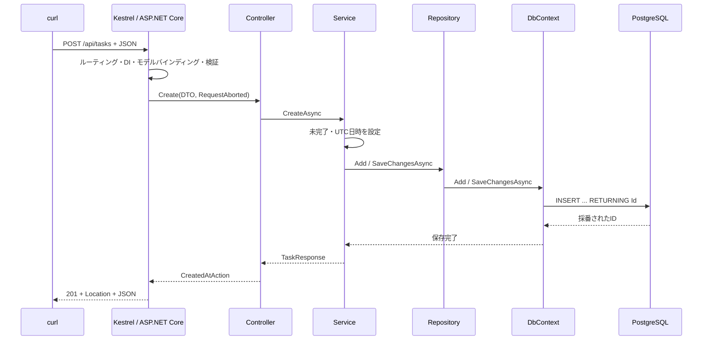

# Task API

ASP.NET Core（.NET 10）とEntity Framework Coreを使用した、Controllerベースのタスク管理APIです。タスクの作成・取得・更新・削除・完了操作と、完了状態によるフィルタリングに対応しています。

API・PostgreSQL・テスト・MigrationをDocker Composeで実行できます。ホストへの.NET SDKやPostgreSQLのインストールは不要です。

| 技術 | 用途 |
| --- | --- |
| C# 14 / .NET 10 | 言語・ランタイム |
| ASP.NET Core | ControllerベースのWeb API・標準DI |
| Entity Framework Core / Npgsql | PostgreSQLへのデータアクセス・Migration |
| DataAnnotations / ProblemDetails | 入力検証・エラーレスポンス |
| OpenAPI | API仕様の生成 |
| xUnit / Microsoft Testing Platform | 単体テスト・結合テスト |

## 1. セットアップ（Docker / macOS / VS Code）

Docker Desktop（Docker Compose付き）を起動し、以下のコマンドをREADMEのあるフォルダーで実行します。

```bash
docker version
docker compose version
docker compose up --build -d
```

初回はイメージ取得・NuGetパッケージ復元・ビルドを行います。PostgreSQLのヘルスチェックが通ると`migrate`サービスがスキーマを更新し、正常終了後に`api`サービスが起動します。

- API: **http://localhost:5080/api/tasks**
- OpenAPI JSON: **http://localhost:5080/openapi/v1.json**

```bash
# 起動状態とログ
docker compose ps -a
docker compose logs --tail=100 api migrate postgres

# APIの応答を確認
curl -i http://localhost:5080/api/tasks
```

`migrate`が`Exited (0)`になっているのは正常です。起動直後はAPIの初期化に数秒かかる場合があります。OpenAPIはDevelopment環境で公開され、ブラウザーやAPIクライアントで確認できます。

### コンテナ構成

| サービス | 用途 | 実行環境 |
| --- | --- | --- |
| `api` | Web APIの実行 | ASP.NET Core Runtime 10.0.14 |
| `migrate` | EF Core Migrationの適用 | .NET SDK 10.0.403 |
| `postgres` | データベース | PostgreSQL 18.6 |
| `test` | 単体テスト・結合テスト | .NET SDK 10.0.403。明示的に実行 |

`Dockerfile`はマルチステージビルドです。SDKで復元・ビルド・publishを行い、API用イメージにはpublish結果とランタイムを配置します。APIプロセスは非rootユーザーで実行します。

`global.json`でSDKとテストランナーを指定しています。対象フレームワークは`net10.0`、言語バージョンは既定のC# 14で、preview機能は使っていません。VS Codeでの補完・デバッグにはC#拡張またはC# Dev KitとローカルSDKを任意で利用できます。

### 接続先と永続化

| 項目 | 設定 |
| --- | --- |
| ホストからAPIへ | `http://localhost:5080` → コンテナ内 `8080` |
| コンテナからDBへ | `postgres:5432` |
| ホストからDBへ | `127.0.0.1:55432` |
| DB / ユーザー | `taskapi` / `taskapi` |
| パスワード | `taskapi_local` |
| DBデータ保存先 | 名前付きボリューム `dotnet-playground-taskapi_postgres_data` |

API・Migration・テストにはComposeから接続文字列を渡します。.NETの環境変数`ConnectionStrings__DefaultConnection`は設定キー`ConnectionStrings:DefaultConnection`を上書きします。コンテナ内の`localhost`はそのコンテナ自身を指すため、DBにはサービス名`postgres`で接続します。

公開ポートはループバックに限定しています。DB認証情報とsuperuserロールは開発用です。接続先や認証情報を変更する場合は、`compose.yaml`のPostgreSQL・API・Migration・テストの設定を揃えてください。`src/TaskApi/appsettings.json`はAPIをホストで動かす場合の既定値です。

```bash
# 全サービスを停止・コンテナとネットワークを削除（DBデータは残る）
docker compose down

# 再起動。コードを変更した場合もこのコマンドで再ビルド
docker compose up --build -d
```

PostgreSQLのデータはコンテナの再作成後も名前付きボリュームに残ります。`docker compose down --volumes`は保存データも削除します。PostgreSQL 18の公式イメージに合わせ、ボリュームは`/var/lib/postgresql`にマウントしています。[公式イメージの保存先仕様](https://hub.docker.com/_/postgres)

DBだけを操作する場合は`bash scripts/db.sh start / stop / status / logs`も使えます。APIと一緒に動かしている場合の停止には`docker compose down`を使います。

### ビルド・テスト

```bash
# APIイメージのビルド（SDK内でdotnet build / publishを実行）
docker compose build api

# SDK・ランタイムのバージョンを確認
docker compose run --rm --no-deps migrate --info

# 全テスト。PostgreSQLが停止していれば先に起動する
docker compose run --rm --build test

# DBなしで単体テストだけ実行
docker compose run --rm --build --no-deps test --filter-trait Category=Unit

# 結合テストだけ実行
docker compose run --rm --build test --filter-trait Category=Integration
```

xUnitとMicrosoft Testing Platformを使用し、`global.json`の`test.runner`でランナーを指定しています。テストの絞り込みにはxUnitの`--filter-trait`を使います。`test`サービスには`tools`プロファイルを指定しているため、通常の`docker compose up`では実行されません。

単体テストはFake RepositoryとStub時計をコンストラクタで注入し、作成・取得・更新・削除・不存在・完了・完了の再実行・CancellationToken伝播を検証します。

結合テストは`WebApplicationFactory<Program>`のインメモリHTTPサーバーと実PostgreSQLを使います。テストごとに`taskapi_tests_<GUID>`というDBを作り、Migrationを適用し、終了時にそのDBだけを削除します。接続ロールにはDB作成・削除権限が必要です。APIコンテナの起動はテストの前提ではありません。

### DBを直接見る

```bash
docker compose exec -e PGPASSWORD=taskapi_local postgres \
  psql -U taskapi -d taskapi -c 'SELECT * FROM "Tasks" ORDER BY "Id";'
```

PostgreSQLでは引用した識別子の大文字小文字を区別するため、`"Tasks"`や`"Id"`には二重引用符が必要です。DBのセッションタイムゾーンにより日時の表示は変わりますが、APIはUTCオフセット`+00:00`で返します。

## 2. APIとcurl実行例

| Method | パス | 成功 | エラー / 備考 |
| --- | --- | --- | --- |
| GET | `/api/tasks` | 200 + 配列 | `?isCompleted=true/false`。不正なboolは400 |
| GET | `/api/tasks/{id}` | 200 + Task | 不存在は404 |
| POST | `/api/tasks` | 201 + Task + Location | 入力不正は400 |
| PUT | `/api/tasks/{id}` | 200 + Task | 入力不正400 / 不存在404 |
| DELETE | `/api/tasks/{id}` | 204・本文なし | 不存在404 |
| PATCH | `/api/tasks/{id}/complete` | 200 + Task | 不存在404。本文不要 |

一覧はID昇順です。結果がなければ200と`[]`を返します。`id`はintのルート制約があり、数値でないパスはルーティング不成立で404です。負数や0は該当データがなく404です。

```bash
BASE_URL=http://localhost:5080

# 作成: 201とLocationヘッダーを確認。以下では返されたidが1の例。
curl -i -X POST "$BASE_URL/api/tasks" \
  -H 'Content-Type: application/json' \
  -d '{"title":"ドキュメントを更新する","description":"API仕様を確認する"}'

# 一覧 / フィルター / 詳細
curl -i "$BASE_URL/api/tasks"
curl -i "$BASE_URL/api/tasks?isCompleted=false"
curl -i "$BASE_URL/api/tasks?isCompleted=true"
curl -i "$BASE_URL/api/tasks/1"

# 更新: titleとisCompletedは必須。descriptionを省略するとnullに置換。
curl -i -X PUT "$BASE_URL/api/tasks/1" \
  -H 'Content-Type: application/json' \
  -d '{"title":"APIドキュメントを更新する","description":"エンドポイントの説明を追加する","isCompleted":false}'

# 完了（繰り返してもUpdatedAtを変えない）
curl -i -X PATCH "$BASE_URL/api/tasks/1/complete"

# 削除: 204、削除後のGETは404
curl -i -X DELETE "$BASE_URL/api/tasks/1"
curl -i "$BASE_URL/api/tasks/1"

# バリデーションエラー: 400
curl -i -X POST "$BASE_URL/api/tasks" \
  -H 'Content-Type: application/json' -d '{"title":"   "}'

# OpenAPI
curl -fsS "$BASE_URL/openapi/v1.json" | python3 -m json.tool
```

IDは自動採番です。実際にはPOSTで返された値を使ってください。PUTは編集可能なフィールド全体を置換し、POSTでは常に未完了で作成します。サーバーがIDと日時を決めるため、それらをリクエストDTOには含めていません。完了を戻す場合はPUTで`isCompleted:false`を送ります。

レスポンス例:

```json
{
  "id": 1,
  "title": "ドキュメントを更新する",
  "description": "API仕様を確認する",
  "isCompleted": false,
  "createdAt": "2026-11-03T12:00:00+00:00",
  "updatedAt": "2026-11-03T12:00:00+00:00"
}
```

Titleは必須・空白だけ不可・最大200文字です。文字数はDataAnnotationsの.NET文字列長（UTF-16コード単位）で検証するため、絵文字などは見た目の1文字が複数として数えられる場合があります。検証後に前後の空白を除去します。Descriptionは任意で、長さ制限は設けていません。

`[ApiController]`はモデルバインディングやDataAnnotationsの失敗を、アクション実行前に400 `ValidationProblemDetails`へ変換します。壊れたJSON、nullの本文、必須フィールド欠落、不正な型も対象です。更新の`isCompleted`欠落は`[JsonRequired]`で検出します。

エラーのContent-Typeは`application/problem+json`です。400には`errors`辞書、404には`title`・`status`・`detail`などが付きます。ProblemDetailsの細部やメッセージは実行環境により変わるので、クライアントでは`status`と検証エラーを中心に扱います。

```json
{
  "title": "Task not found.",
  "status": 404,
  "detail": "Task with ID 999 does not exist."
}
```

未処理例外は例外処理ミドルウェアと`AddProblemDetails`で500へ変換し、詳細はサーバーログへ記録します。予期した「データなし」は例外にせずServiceから`null`/`false`を返し、Controllerで404へ変換します。

## 3. ファイル構成と読む順番

```text
TaskApi.slnx                         # APIとテストをまとめるソリューション
global.json                         # SDKとテストランナー
dotnet-tools.json                   # ローカルdotnet-efのバージョン
Dockerfile                          # ビルド・テスト・APIランタイムの各ステージ
.dockerignore                       # ビルド対象外のローカルファイル
compose.yaml                        # API・Migration・PostgreSQL・テスト
scripts/db.sh                       # Docker Composeの操作ラッパー
src/
└── TaskApi/
    ├── Controllers/TasksController.cs
    ├── Application/
    │   ├── Interfaces/ITaskService.cs
    │   └── Services/TaskService.cs
    ├── Domain/Entities/TaskItem.cs
    ├── Infrastructure/
    │   ├── Data/
    │   │   ├── AppDbContext.cs
    │   │   └── Migrations/
    │   └── Repositories/
    │       ├── ITaskRepository.cs
    │       └── TaskRepository.cs
    ├── Contracts/
    │   ├── Requests/
    │   └── Responses/TaskResponse.cs
    ├── Program.cs
    ├── appsettings.json
    └── TaskApi.csproj
tests/
└── TaskApi.Tests/
    ├── TaskApi.Tests.csproj
    ├── TaskServiceTests.cs
    ├── Doubles/                     # Fake Repository / Stub時計
    └── Integration/                 # HTTP + 実DBのテスト
```

最初に`Program.cs`→`TasksController`→`TaskService`→`TaskRepository`→`AppDbContext`→`TaskServiceTests`の順に読むと、依存関係と実行のつながりを追いやすくなります。`TaskItem`という名前は、非同期処理の`System.Threading.Tasks.Task`との衝突を避けるためです。

## 4. リクエスト処理と各レイヤーの役割



**Controller → Service → Repository → DbContext → PostgreSQL**が基本の流れです。

| 層 | 役割 | 分ける理由 |
| --- | --- | --- |
| Controller | URL・HTTPメソッド・DTOを受け、HTTPステータスを決定 | HTTPの都合をServiceから分ける |
| Service | 作成初期値・更新時刻・完了ルール、DTOへの変換 | DBなしでユースケースをテストする |
| Repository | LINQによる検索、追加・削除・保存の窓口 | EFのクエリ処理をまとめ、Serviceで差し替える |
| DbContext | モデル設定、変更追跡、SQL実行、SaveChanges | EFがDB操作の単位を管理する |
| Entity | DBへ永続化するタスクの状態 | API契約からDBの状態を分ける |
| Request / Response DTO | 公開する入出力と入力検証 | IDや日時をクライアントが上書きすることを防ぐ |

KestrelがHTTPを受け、ミドルウェアのパイプラインを通し、該当エンドポイントでMVCが動きます。`WebApplication`は必要なルーティング処理を組み込み、`MapControllers()`が属性ルートのアクションを登録します。MVCのモデルバインディング・検証・フィルターは、ミドルウェアと関連しますが別の仕組みです。

Controllerの`CancellationToken`には`HttpContext.RequestAborted`がバインドされます。同じトークンをService→Repository→`ToListAsync`/`SingleOrDefaultAsync`/`SaveChangesAsync`へ渡します。クライアント切断などの通知に協調して処理を止める仕組みで、即時停止やDB変更の必ずの巻き戻しを保証するものではありません。

## 5. Program.csとDI

`Program.cs`はアプリの組み立て場所（Composition Root）です。設定・ログ・ホストを初期化し、DI登録を行い、`Build()`後にミドルウェアとエンドポイントを構成して`Run()`します。NestJSの`main.ts`とModuleのProvider登録に分かれる仕事の一部がここにまとまります。

```csharp
builder.Services.AddDbContext<AppDbContext>(options => options.UseNpgsql(connectionString));
builder.Services.AddScoped<ITaskRepository, TaskRepository>();
builder.Services.AddScoped<ITaskService, TaskService>();
builder.Services.AddSingleton<TimeProvider>(TimeProvider.System);
```

Controllerを作るとき、DIコンテナが`ITaskService`→`TaskService`→`ITaskRepository`→`TaskRepository`→`AppDbContext`というコンストラクタの依存を解決します。Service側で`new TaskRepository(...)`と書く必要はありません。

| 登録方法 | 生存期間 | 使用箇所 |
| --- | --- | --- |
| `AddScoped` | スコープ内で同じインスタンス。通常HTTPリクエストごとに1つ | Service・Repository・DbContext |
| `AddSingleton` | コンテナ全体で1つ | スレッドセーフなSystem時計 |
| `AddTransient` | 解決するたびに生成 | 使用なし。解決ごとに生成する補助処理などに利用 |

`AddDbContext`は既定でScopedです。同じリクエスト内でRepositoryとDbContextを共有し、終わればコンテナが破棄します。Transientも所有スコープで破棄される対象は管理されます。Singletonは複数リクエストから同時に使われ得るため、共有状態の扱いが必要です。

**DbContextはスレッドセーフではありません。** Singletonに注入して長期間保持したり、同じContextに対するクエリを`Task.WhenAll`で並列実行したりしません。バックグラウンド処理では明示的なスコープや`IDbContextFactory`を検討します。

### NestJSのDIと実行時の違い

NestJSは`@Module()`/`@Injectable()`などのメタデータとProviderを使い、標準ではSingletonに相当する生存期間です。リクエストスコープやTransientは明示して選びます。.NETは型と登録APIを使い、このAPIのServiceはScopedで登録しています。

C#の`interface`は実行時にも.NET型として存在するため、`AddScoped<ITaskService, TaskService>()`という型そのものの登録キーにできます。TypeScriptの`interface`はJavaScriptへの変換で消えるため、NestJSでinterfaceに対して注入するときは文字列・Symbol・抽象クラスなどの実行時トークンが必要です。コンストラクタへ渡すという発想は共通です。

`TaskService(ITaskRepository repository, TimeProvider timeProvider)`はC#の**プライマリコンストラクタ**です。従来のコンストラクタ＋フィールド形式を短く書けます。引数が自動的にpublicプロパティになるわけではありません。

## 6. EF CoreとDrizzleの比較

### クエリと変更追跡

EF CoreはC#のEntityクラスとモデル設定を基にDBを扱うORMです。`DbSet<TaskItem>`はタスクへのクエリ・追加などの入口で、DBテーブル全体を常時メモリに載せる配列ではありません。

```csharp
var query = dbContext.Tasks.AsNoTracking();
query = query.Where(item => item.IsCompleted == completed);
var tasks = await query.OrderBy(item => item.Id).ToListAsync(cancellationToken);
```

この`Where`は`IQueryable`上の式ツリーとして蓄積され、`ToListAsync`でパラメーター化されたSQLへ翻訳されて実行されます。JavaScriptの配列`filter`のように全行取得後に実行しているわけではありません。Serviceの`tasks.Select(ToResponse)`はすでに取得したオブジェクトのメモリ上の変換です。

更新は次のようになります。

```csharp
var task = await dbContext.Tasks.SingleOrDefaultAsync(item => item.Id == id, cancellationToken);
if (task is null) return;
task.Title = "更新";
await dbContext.SaveChangesAsync(cancellationToken);
```

EFのChange Trackerが元の値と変更後の値を把握し、保存時に必要なUPDATEを生成します。`Add`や`Remove`もまず追跡状態を変え、実際のINSERT/DELETEは`SaveChangesAsync`で行います。通常の単一`SaveChangesAsync`で複数変更があれば、リレーショナルプロバイダーは必要に応じてトランザクションでまとめます。複数回のSaveChangesをまたぐ業務処理には別途トランザクション設計が必要です。

一覧は変更しないので`AsNoTracking()`で追跡コストを省いています。単体取得は更新処理とメソッドを共用しているため追跡ありです。読み取り専用の詳細取得をさらに最適化するなら、DTO投影や読み取り用メソッドを追加できます。

### Drizzleとの設計の違い

| 観点 | EF Core | Drizzle |
| --- | --- | --- |
| モデル | C#のEntity + Fluent API / 属性 | TypeScriptのテーブル定義（`pgTable`など） |
| 取得結果 | 既定ではDbContextがEntityの変更を追跡 | 行データのオブジェクト。プロパティを書き換えるだけではDBへ保存されない |
| 保存 | 追跡した変更を`SaveChangesAsync()`で反映 | `db.insert()` / `db.update()` / `db.delete()`を明示的に実行 |
| 検索 | LINQ式をプロバイダーがSQLへ翻訳 | `select`・`where`・`eq`などでSQLに近いクエリを組み立てる |
| トランザクション | 単一SaveChangesの保存処理を必要に応じてまとめる | 複数の操作は`db.transaction()`で明示的にまとめる |
| Migration | Entityとスナップショットの差分からC#コードを生成 | Drizzle KitでTypeScriptスキーマの変更からSQLを生成・適用 |

Drizzleで同じタイトル更新を書く場合、更新する値と条件を明示します。以下は比較用のコードで、`db`と`tasks`は接続設定とテーブル定義を読み込んだものとします。

```typescript
import { eq } from "drizzle-orm";

await db.update(tasks)
  .set({ title: "更新" })
  .where(eq(tasks.id, id));
```

EF Coreの例は「Entityを取得 → プロパティを変更 → SaveChanges」、Drizzleの例は「UPDATEする値と条件を指定 → 実行」という流れです。DrizzleにはEFのChange Trackerに相当する自動追跡がないため、読み取り時に`AsNoTracking`へ切り替える必要もありません。EF Coreにも`ExecuteUpdateAsync`で取得・追跡を省く更新方法がありますが、このAPIでは変更追跡とSaveChangesを使用しています。[Drizzleの更新API](https://orm.drizzle.team/docs/update)

Drizzleでnode-postgresの接続プールを使う場合、`db`はプールを利用するクエリの入口として共有できます。一方、EF CoreのDbContextは変更追跡状態を持つため、リクエストごとの短命なインスタンスとして扱います。DbContextの寿命とDB接続プールの寿命は別で、Npgsql側の接続プールは再利用されます。[Drizzleとnode-postgresの接続設定](https://orm.drizzle.team/docs/get-started-postgresql)

複数の操作を一体として保存する場合、Drizzleでは`db.transaction(async (tx) => { ... })`の中で`tx`を使って実行します。EF Coreでも複数のSaveChangesをまたぐ処理は、明示的なトランザクションを検討します。いずれも、トランザクションの原子性と、競合更新の検出・防止は別の設計上の問題です。[Drizzleのトランザクション](https://orm.drizzle.team/docs/transactions)

EFのLINQも任意のC#コードをSQL化できるわけではありません。翻訳できない式、N+1クエリ、過剰な全件取得に注意し、SQLと取得量を確認します。Repositoryを追加しても、DB固有の型・LINQ翻訳・Migrationまで自動的に別DBへ移植できるわけではありません。

### Migration

初回Migrationとモデルスナップショットを同梱しています。EFは現在のDBを毎回比較してコード生成するのではなく、主に**現在のモデルと前回スナップショットとの差分**からMigrationを作ります。適用済み履歴はDBの`__EFMigrationsHistory`で管理します。

```bash
# Entityやモデル設定を変更した後、生成ファイルをホストへ保存
# --buildで変更後のソースをSDKイメージへ反映する
docker compose run --rm --build \
  --volume "$PWD/src/TaskApi/Infrastructure/Data/Migrations:/workspace/src/TaskApi/Infrastructure/Data/Migrations" \
  migrate ef migrations add DescribeYourChange --project src/TaskApi \
  --configuration Release --no-build --output-dir Infrastructure/Data/Migrations

# 生成されたUp/Downを確認し、MigrationとAPIを再ビルドして起動
docker compose up --build -d

# 未反映のモデル変更がないか確認
docker compose run --rm --build migrate ef migrations has-pending-model-changes \
  --project src/TaskApi --configuration Release --no-build

# SQLとして確認（最初から最新まで）
docker compose run --rm --build migrate ef migrations script \
  --project src/TaskApi --configuration Release --no-build
```

EF CoreのMigrationはC#コードです。Drizzle Kitでは`drizzle-kit generate`でSQL Migrationを生成し、`drizzle-kit migrate`で適用できます。どちらも適用前に生成物を確認します。[DrizzleのMigration](https://orm.drizzle.team/docs/migrations) `EnsureCreated`はMigration履歴を使うスキーマ更新の代替ではないので混在させません。

### 日時の扱い

`TimeProvider.System.GetUtcNow()`でUTCの`DateTimeOffset`を取得し、作成時はCreatedAtとUpdatedAtを同じ値にします。PUTと初回完了でUpdatedAtだけ更新し、完了済みへの再度の完了は日時も維持します。

NpgsqlはUTCオフセット0の`DateTimeOffset`をPostgreSQLの`timestamptz`へ保存します。`timestamptz`は時点を保持し、元のタイムゾーン名やオフセットを保持しません。このAPIでは日時をサーバー側でUTCに統一します。PostgreSQLの日時精度はマイクロ秒で、.NETの100ナノ秒精度から保存時に端数が落ち得ます。テストの時計はこの精度差に影響されない値です。[Npgsqlの日時仕様](https://www.npgsql.org/doc/types/datetime.html)

## 7. TypeScript / Node.jsとの対応とC#の特徴

| .NET | TypeScript / Node.jsで近いもの | 理解するポイント |
| --- | --- | --- |
| ASP.NET Core Controller | NestJS Controller | 属性でルートとHTTPメソッドを宣言。`ControllerBase`はAPI向け |
| Service + interface | NestJS Provider + 契約 | interfaceが.NETの実行時型として存在し、DIに使える |
| 標準DI | NestJS DI | 登録・解決と寿命管理。このAPIではScoped、NestJSの既定はSingleton相当 |
| EF Core | Drizzle | EFは変更追跡とSaveChanges、Drizzleは明示的なクエリ実行が中心 |
| LINQ | 配列操作 / ORMクエリ | IEnumerableはメモリ操作、IQueryableはSQL翻訳される式になり得る |
| record | DTOの型 / readonlyなデータ | 実行時の型と値の等価比較を持ち、JSのtypeとは異なる |
| Task / async-await | Promise / async-await | 非同期の結果。スレッド・継続・キャンセルの仕組みは異なる |
| NuGet | npm | .csprojのPackageReferenceとdotnet restore。アセンブリ/TFMに対応 |

### record / nullable / 属性

`TaskResponse`は`record`です。実行時にオブジェクトとして存在し、同じ型で同じ値を持つrecord同士は値として等しいと判定できます。`with`で一部を置き換えたコピーも作れます。DTOに使用し、EF Entityには参照の同一性が重要な`class`を使用しています。

`record`だから必ず不変になるわけではありません。`init`を使うDTOは初期化後のプロパティ代入を制限しますが、内部に可変リストを持てばリストは変更できます。深い不変性を自動で保証する機能ではありません。TypeScriptの`type`/`interface`や`readonly`のように型チェック後に消えるものとも異なります。

`<Nullable>enable</Nullable>`によって`string`と`string?`をコンパイラーが区別します。`TaskResponse?`は「存在しないためnullを返せる」契約です。Nullable Reference Typesは主に静的解析であり、不正なHTTP入力を実行時に拒否する仕組みではありません。

C#の`required`はオブジェクト初期化時の指定を要求し、JSONでは必須メンバーの扱いにも関係しますが、空文字や最大長は検査しません。入力DTOでは`[Required]`と`[StringLength]`で実行時検証を行います。属性（Attribute）は実行時メタデータになり、MVCやシリアライザーが読み取ります。

`if (isCompleted is { } completed)`はnull以外を取り出すパターンマッチングです。`false`も正しく取り出せるので、未指定とfalseを区別できます。完了状態にはboolが自然なのでenumは追加していません。

### TaskとPromiseの違い

`Task<T>`は将来完了する処理の結果を表し、戻り値なしなら`Task`です。多くの.NET非同期APIは呼び出しで処理を始め、`await`は完了を待って継続します。`Task`自体がスレッドを表すわけではありません。`async`メソッドは未完了のawaitに達するまで同期的に進み、完了後の継続がスケジュールされます。

JavaScriptのPromiseも将来の結果を表しますが、JSコードの継続はイベントループとマイクロタスクで実行されます。.NETはThreadPoolなどで複数リクエストや継続を複数スレッド上で処理でき、ASP.NET Coreには通常専用のSynchronizationContextがありません。awaitの前後が同じスレッドであるとは限りません。Node.jsでも、OSの非同期I/Oやlibuvのスレッドプール、Worker Threadsが使われます。

I/Oを待つ間にHTTPワーカースレッドを占有しないのが非同期APIの利点です。DB呼び出しに`Task.Run`を足す必要はありません。`.Result`や`.Wait()`で同期ブロックすることも避けます。`Task.WhenAll`はPromise.allに近い用途ですが、同じDbContextの並列利用には使えません。

.NETはCancellationTokenを渡して協調キャンセルし、Taskにはキャンセル済み状態があります。JSのPromise自体にキャンセル機能はなく、fetchなどにAbortSignalを渡して処理の中断を求める点が近いです。どちらも相手の処理が中断に対応している必要があります。

### NuGetとビルド

`.csproj`は対象フレームワーク（TFM）、コンパイラー設定、パッケージ参照を持つプロジェクト定義です。`dotnet restore`はNuGet依存を解決し、`dotnet build`はC#をアセンブリへコンパイルします。通常実行では.NETランタイムがILをJITコンパイルして実行します。npmパッケージと同様に推移的依存はありますが、.NETではアセンブリのバージョン整合性や対象TFMへの対応も重要です。

EF Coreは10.0.14、Npgsql EFプロバイダーは10.0.3を使用しています。両者のパッチ番号が一致する必要はなく、プロバイダーの対応するEFのメジャーと依存範囲を揃えます。`Microsoft.EntityFrameworkCore.Relational`を明示して、Designパッケージの非推移的参照にかかわらずAPI・テストで同じEFパッチを使います。`dotnet-ef`はリポジトリのツールマニフェストで10.0.14に固定しています。

## 8. 設計方針

ControllerでHTTP入出力を扱い、Serviceでタスク操作を実装し、RepositoryにEF Coreのクエリ処理をまとめています。ServiceとRepositoryにはinterfaceを定義し、単体テストでは依存先をFakeに差し替えます。

API契約にはDTOを使用し、Entityを直接公開しません。データの変更追跡と保存単位はDbContextに任せ、独自のUnit of Workや汎用Repositoryは追加していません。

API本体は1プロジェクトとし、フォルダー単位で責務を分けています。ApplicationはInfrastructure内のRepository契約を参照するため、厳密なClean Architectureの依存方向にはしていません。

## 9. 実装範囲と制約

- 認証・認可、マルチテナント、ページネーションは含みません。一覧は全件取得します。
- 入力検証はMVCのHTTP境界で行います。Serviceを直接呼び出す場合、DataAnnotationsの検証は自動実行されません。
- 単体取得は追跡ありのRepositoryメソッドを共有し、一覧取得には`AsNoTracking`を使用します。
- 楽観的同時実行制御は未実装です。通常の更新競合では後の保存が優先され、取得後に別リクエストが削除した場合の同時実行例外は一般的な500応答になります。
- 日時はアプリの時計で決定します。DBトリガーや変更履歴の記録は行いません。
- 開発環境ではHTTPと開発用のDB認証情報を使用します。公開運用向けのTLS・認証・DB権限分離などは含みません。
- 初期データの投入は行いません。MigrationはAPIプロセスでは実行せず、Composeの独立した`migrate`サービスが適用します。

## 10. 公式資料

- [Drizzleのテーブル定義](https://orm.drizzle.team/docs/sql-schema-declaration)
- [Drizzleの更新API](https://orm.drizzle.team/docs/update)
- [DrizzleのMigration](https://orm.drizzle.team/docs/migrations)
- [Drizzleのトランザクション](https://orm.drizzle.team/docs/transactions)
- [.NETのDockerコンテナ](https://learn.microsoft.com/dotnet/core/docker/introduction)
- [PostgreSQL公式Dockerイメージ](https://hub.docker.com/_/postgres)
- [Composeのヘルスチェックと起動順序](https://docs.docker.com/compose/how-tos/startup-order/)
- [ControllerベースのWeb API / ApiController](https://learn.microsoft.com/aspnet/core/web-api/?view=aspnetcore-10.0)
- [ASP.NET Core OpenAPI](https://learn.microsoft.com/aspnet/core/fundamentals/openapi/aspnetcore-openapi?view=aspnetcore-10.0)
- [.NET標準DI](https://learn.microsoft.com/dotnet/core/extensions/dependency-injection/overview)
- [DbContextの生存期間と構成](https://learn.microsoft.com/ef/core/dbcontext-configuration/)
- [EF Core Migration](https://learn.microsoft.com/ef/core/managing-schemas/migrations/)
- [Npgsql EF Coreプロバイダー](https://www.npgsql.org/efcore/)
- [Npgsql 10のEFプロバイダー](https://www.npgsql.org/efcore/release-notes/10.0.html)
- [Npgsqlの日時型](https://www.npgsql.org/doc/types/datetime.html)
- [xUnitとMicrosoft Testing Platform](https://xunit.net/docs/getting-started/v3/microsoft-testing-platform)
